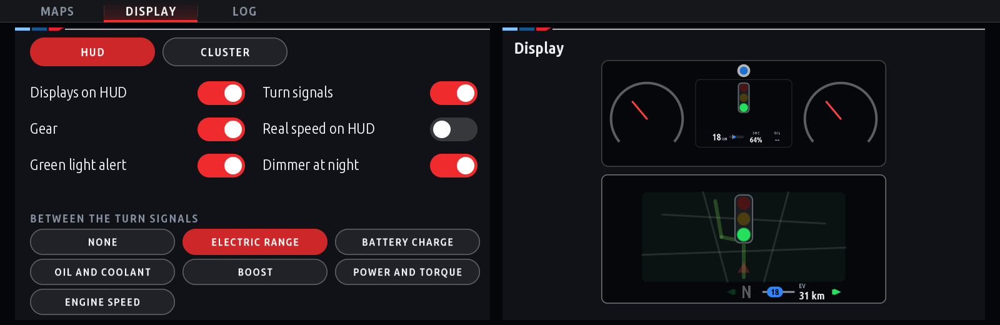
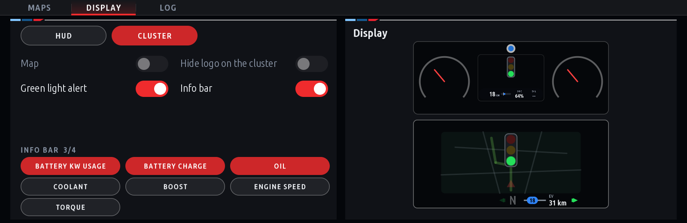
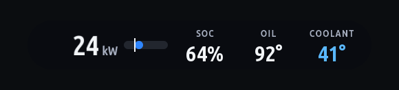

# Cluster-apps

**Cluster functions** for BMWs with iDrive 7: the CarPlay or Android Auto map (Waze, Apple Maps, Google Maps) on the
instrument cluster and the head-up display, and live values beside it, installed from
[TheoneLT83's MGU Store](https://github.com/TheoneLT83/mgu-store), in the look of the
[idrive7-apps](https://github.com/TheoneLT83/idrive7-apps).

## What it does

- **The map on the cluster, the HUD, or both** (Maps page): its size, place and brightness on the HUD, the map alone
  (BMW's own HUD content keeps its brightness); BMW's guidance logo on the cluster can be hidden.
- **The info bar on the cluster** (Display > Cluster): up to four values in a dark see-through bar under the map:
  **Battery kW usage** (with a bar from zero, a quarter along: recuperating to the left in green, driving to the right
  in blue to purple, each side up to the battery's limit now), battery charge, oil, coolant (blue while cold), boost,
  engine speed or torque. The page counts how many are on (2/4).
- **The HUD** (Display > HUD): turn signal arrows, the gear (with S / M), the real speed, and between the turn signals
  one reading: electric range, battery charge, oil and coolant, boost, power and torque, or engine speed.
- **Battery power as fast as the car's eDRIVE needle**, with [eDrive](https://github.com/TheoneLT83/idrive7-apps)
  2.9: eDrive works the kW out from the cluster's own needle and the AC compressor, learned from its battery readings,
  and the cluster and the HUD show each new value at once.
- **Green light alert**: a small traffic light on the cluster and the HUD when the light ahead turns green.
- **Dimmer at night**: the HUD's parts at 40 % after dark (the car's light sensor).
- **Redline's HUD in Sport**: with [Redline](https://github.com/TheoneLT83/idrive7-apps), Cluster functions has the
  HUD in Comfort, Eco Pro and the hybrid modes, and gives it to Redline's rev tach in Sport.
- **Own settings for each driver**, and a Log page that saves the logs for a report.

| Display > HUD | Display > Cluster |
|---|---|
|  |  |
| What shows on the HUD, and the reading between the turn signals; on the right the cluster and the HUD as they are now | The map, BMW's logo, the green light, the info bar and its items |



*The info bar: Battery kW usage with its bar, charge, oil and coolant (cold: blue).* Screens rendered with demo data.

## The map on the HUD

Photos from a 2021 X5 xDrive45e (G05), street names blurred. HUD support was contributed by
[eroobeeroo](https://github.com/eroobeeroo) and [wesleyredhat](https://github.com/wesleyredhat).


| Waze's grey-blue night field | Made black, which a HUD shows as nothing |
|---|---|
|  |  |

- The map is scaled on the head unit to the size shown, at most 10 frames a second, with rounded corners; a night
  map's background is made black, so only the roads, the route and the labels float in view.
- It steps aside while the HUD's own media and list pop-ups show, and never replaces BMW's own HUD content.
- If the cluster restarts right after the HUD map shows, twice, the HUD map stays off until the next cluster-render
  version; the cluster's map keeps working.


## Install

Cluster-apps is a default source of [TheoneLT83's MGU Store](https://github.com/TheoneLT83/mgu-store) and of the
iDrive7 Assistant: install **Cluster functions** in the Store. The Store installs its requirements first: the deploy
tool and the Store's renderer `mgu-render` from the Store's own source, then `cluster-render` and `waze-on-cluster`
from here. One head-unit start activates the CarPlay patch, and the Android Auto patch on a car that supports it. The
Store removes them again: the app, then the tool, then the renderer.

| Path | |
|---|---|
| [`apps/robertn_waze_cluster`](apps/robertn_waze_cluster) | **Cluster functions**, the iDrive app, drawn by the Store's renderer with the idrive7-apps kit |
| [`native/cluster-render`](native/cluster-render) | the cluster renderer: one service that draws every app's layers on the instrument cluster and the HUD |
| [`native/waze-on-cluster`](native/waze-on-cluster) | the CarPlay or Android Auto map on the cluster and the HUD, drawn through cluster-render |
| [`kit`](kit) | the idrive7-apps app kit (MIT) the app is built with |
| [`release`](release) | builds and publishes the Store catalog |

## Build

```sh
make -C native/cluster-render test test-x86 target    # host tests; the unit's toolchain and binary (Docker)
make -C native/waze-on-cluster test test-x86 target
node apps/robertn_waze_cluster/tools/test_control.js
node apps/robertn_waze_cluster/tools/test_hud.js native/cluster-render/build/host/host_service
node apps/robertn_waze_cluster/tools/test_i18n.js
node release/test/release_test.js
node release/release.js check                         # reproducible artifacts
```

Each folder's README has the details; [`release/README.md`](release/README.md) covers versions, the catalog and
publishing.

## Credits and licence

Cluster-apps is TheoneLT83's fork of [robertnisipeanu/idrive-apps](https://github.com/robertnisipeanu/idrive-apps)
(Waze on cluster and the cluster renderer, by Robert Nisipeanu), with the HUD work of eroobeeroo and wesleyredhat.

GPL-3.0-or-later ([`LICENSE`](LICENSE)), unless a file's SPDX header says otherwise. What apps compile in or copy
from cluster-render, its `include/`, `client/`, `kit/`, `js/cluster_render_client.js` and `PROTOCOL.md`, is MPL-2.0
([`LICENSES/MPL-2.0.txt`](LICENSES/MPL-2.0.txt)). Third-party files keep their own licenses: the RAMSES and vsomeip
interfaces in cluster-render (MPL-2.0), the Intel Media SDK headers in waze-on-cluster (MIT), Project Nayuki's QR
code generator in robertn_waze_cluster (MIT).
